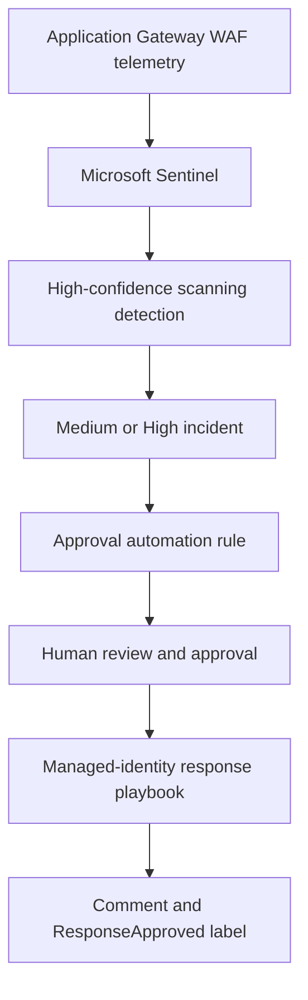

# NorthStar Sentinel and Approval-Gated SOAR Operating Model

**Implementation date:** October 11, 2026  
**Status:** Live controls implemented and validated in the NorthStar portfolio environment

## Executive Summary

NorthStar now has a validated Microsoft Sentinel operating model that combines telemetry-based detection engineering, incident lifecycle management, human approval controls, least-privilege automation, and auditable response execution.

The implementation replaced a noisy Application Gateway WAF rule with a behavior-based detection derived from 30 days of telemetry. It also introduced an automation rule that prepares Medium- and High-severity incidents for review without performing automatic containment.

A manually invoked Logic App provides the controlled response stage. It uses a system-assigned managed identity, records its execution in the incident, and applies a `ResponseApproved` label. The playbook cannot execute through Sentinel until the required human, Sentinel service, and playbook identity permissions are present.

No destructive containment was automated.

## Problem Addressed

The original WAF rule created an incident from every individual WAF match. This generated hundreds of low-value incidents and provided insufficient behavioral context for analysts.

The environment also lacked an enforced operating boundary between:

1. Automated incident preparation
2. Human authorization
3. Response execution
4. Incident closure and lessons learned

The project addressed both problems without deleting telemetry or concealing previous alerting behavior.

## Implemented Architecture

## Detection Engineering

### Previous rule

`NorthStar - Application Gateway WAF Rule Match`

The previous rule detected any WAF match. It was useful for initial telemetry validation but was too broad for sustainable incident generation.

Final state: **Disabled, retained for auditability**

### Telemetry baseline

Thirty days of sanitized aggregate telemetry showed:

| Measure | Result |
|---|---:|
| WAF matches | 7,404 |
| Distinct clients | 347 |
| Distinct paths | 842 |
| Distinct WAF rules | 46 |
| Active five-minute buckets | 485 |
| Average matches per active bucket | 15.27 |
| 95th percentile | 83 |
| 99th percentile | 251 |
| Peak | 394 |

These values were used to replace intuition-based thresholds with evidence-based tuning.

### Replacement rule

`NorthStar - High-Confidence WAF Scanning Activity`

The rule detects concentrated behavior from one client within five minutes when all three conditions are met:

- At least 100 WAF matches
- At least 10 distinct WAF rules
- At least 30 distinct request paths

The rule is mapped to:

- MITRE ATT&CK tactic: Reconnaissance
- MITRE ATT&CK technique: T1595 — Active Scanning
- Severity: Medium

### Detection validation

| Test | Expected result | Actual result | Status |
|---|---|---|---|
| Thirty-day positive test | Historical qualifying activity exists | 5 events from 4 sources | Passed |
| Last-24-hour negative test | No current qualifying activity | 0 events | Passed |
| Staged deployment | Rule exists but cannot create alerts | Disabled and verified | Passed |
| Enabled deployment | Tuned rule operates in Sentinel | Enabled | Passed |
| Legacy-rule transition | No further broad WAF incidents | Legacy rule disabled | Passed |

## Incident Remediation

The original rule had generated 455 Low-severity WAF incidents.

Each eligible incident was:

- Selected by exact title, severity, and status
- Closed through the Sentinel incident API
- Classified as `FalsePositive`
- Assigned the reason `IncorrectAlertLogic`
- Given a standardized analyst explanation
- Preserved rather than deleted

The final Sentinel queue contained:

| Status | Count |
|---|---:|
| Total | 467 |
| New | 0 |
| Active | 0 |
| Closed | 467 |

This remediation restored the queue to an operationally usable state while preserving the historical record.

## Sentinel Operating Model

| Stage | Primary activity | Control |
|---|---|---|
| Collect | Ingest Azure and WAF telemetry | Log Analytics and Sentinel |
| Detect | Apply tuned analytics logic | Version-controlled KQL and Bicep |
| Triage | Validate severity, scope, and context | Analyst review |
| Investigate | Review entities, timeline, telemetry, and business impact | Sentinel incident record |
| Approve | Confirm evidence, scope, impact, rollback, and approver | Approval task and label |
| Respond | Invoke the approved playbook manually | RBAC and managed identity |
| Close | Classify the incident and document the outcome | Closure comment and classification |
| Improve | Tune rules and update procedures | Pull request and validation controls |

## Target Severity and Response Model

These are NorthStar operating targets, not production performance claims.

| Severity | Initial review target | Approval expectation | Response approach |
|---|---:|---|---|
| High | 15 minutes | Incident lead or designated approver | Immediate coordinated response |
| Medium | 60 minutes | Analyst records approval before playbook execution | Controlled response |
| Low | One business day | Analyst discretion | Triage, tune, or close |
| Informational | Periodic review | Not normally required | Trend analysis |

## Responsibility Model

| Activity | SOC analyst | Incident approver | Sentinel platform owner | Automation identity |
|---|---|---|---|---|
| Review alert evidence | Responsible | Informed | Consulted | Not applicable |
| Set incident scope and severity | Responsible | Consulted | Consulted | Not applicable |
| Authorize containment | Consulted | Accountable | Informed | Not applicable |
| Maintain detection logic | Consulted | Informed | Accountable | Not applicable |
| Invoke approved playbook | Responsible | Approval required | Consulted | Executes actions |
| Change automation permissions | Informed | Informed | Accountable | Not applicable |
| Record response action | Informed | Informed | Informed | Responsible |

## Approval Automation

The enabled automation rule is:

`NorthStar - Require Approval for Medium and High Incidents`

When a Medium- or High-severity incident is created, the rule:

1. Changes the incident status to Active.
2. Adds the `ApprovalRequired` label.
3. Creates the task `Obtain approval before containment`.

The task requires validation of:

- Scope
- Evidence
- Business impact
- Rollback
- Approver identity

The automation does not execute containment.

### Positive test

A controlled Medium-severity incident:

- Changed from New to Active
- Received `ApprovalRequired`
- Received the approval task

Result: **Passed**

### Negative test

A controlled Low-severity incident:

- Remained New
- Received no approval label
- Received no approval task

Result: **Passed**

This demonstrated that the rule included its intended scope and excluded Low-severity incidents.

## Approved Response Playbook

The deployed Logic App is:

`NorthStar-Approved-Incident-Response`

The playbook:

- Uses a system-assigned managed identity
- Is invoked manually after recorded approval
- Adds an execution comment to the Sentinel incident
- Adds the `ResponseApproved` label
- Performs no destructive containment
- Stores no reusable Azure credential in the repository

### Authorization model

| Actor | Role | Purpose |
|---|---|---|
| Human operator | Microsoft Sentinel Playbook Operator | Authorizes manual playbook execution |
| Microsoft Sentinel service | Microsoft Sentinel Automation Contributor | Permits Sentinel to invoke the Logic App |
| Logic App managed identity | Microsoft Sentinel Responder | Permits the playbook to update incidents |

The playbook identity received no Owner, Contributor, or User Access Administrator role.

## End-to-End Validation

A controlled Medium-severity incident demonstrated the complete lifecycle:

1. Sentinel created the incident.
2. The automation rule marked it Active.
3. `ApprovalRequired` was added.
4. An approval task was created.
5. The Logic App had zero runs before approval.
6. The operator completed the approval task.
7. The approved playbook was invoked manually.
8. The Logic App run succeeded.
9. A response comment was written to the incident.
10. `ResponseApproved` was added.
11. The incident was classified and closed.
12. Both audit labels were preserved.

Result: **Passed**

## Failure and Recovery Validation

The first manual invocation was denied because the required Sentinel playbook authorization was not yet configured.

The failure caused no playbook run and no response action.

The remediation was:

1. Assign Microsoft Sentinel Automation Contributor to the Sentinel service identity.
2. Assign Microsoft Sentinel Playbook Operator to the human operator.
3. Retain Microsoft Sentinel Responder for the Logic App identity.
4. Retry the same approved action.
5. Verify successful execution and incident updates.

The failed control-plane operation was itself detected by Sentinel. Its resulting incident received the approval workflow, was investigated, and was closed as `BenignPositive` with reason `SuspiciousButExpected`.

This demonstrated both preventive RBAC enforcement and detective monitoring.

## Security Design

### Human authorization boundary

Detection and triage may be automated. Response execution remains a deliberate human decision.

### Least privilege

Separate identities and roles are used for:

- Human invocation
- Sentinel orchestration
- Playbook incident updates

### Credential-free execution

The Logic App uses managed identity authentication. No client secret, password, token, or connection string is stored in source control.

### Evidence preservation

Legacy incidents and the original rule were retained. The project documents what failed, why it failed, and how it was corrected.

### Safe automation

The playbook records an approved action but does not disable accounts, block addresses, isolate systems, revoke sessions, or modify production infrastructure.

## Rollback and Recovery

If the tuned detection produces unacceptable results:

1. Disable the high-confidence rule.
2. Review recent alerts and threshold behavior.
3. Adjust the version-controlled KQL and Bicep.
4. Deploy disabled.
5. validate against historical telemetry.
6. Re-enable only after review.

If approval automation behaves incorrectly:

1. Disable the automation rule.
2. Preserve affected incidents.
3. Review its severity condition and actions.
4. Redeploy disabled.
5. Repeat positive and negative tests.

If the response playbook behaves incorrectly:

1. Stop manual invocation.
2. Disable the Logic App.
3. Review run history and incident changes.
4. Remove or reduce its workspace role if required.
5. Correct the version-controlled template.
6. Redeploy and perform controlled validation.

## Operational Lessons

- Detection volume is not the same as detection quality.
- Thresholds should be justified with telemetry.
- Positive testing alone is insufficient; exclusions require negative testing.
- Incident remediation should preserve evidence and classification history.
- Automation must have a clear human decision boundary.
- Managed identity removes stored credentials but does not replace RBAC design.
- Incident update commands can replace existing labels unless all required labels are explicitly preserved.
- Failed authorized changes are valuable evidence when detected, investigated, and documented honestly.

## Scope and Limitations

This is controlled NorthStar portfolio work, not employer production experience.

The implementation proves:

- Sentinel detection engineering
- KQL tuning
- Bicep deployment
- Incident remediation
- Automation-rule design
- Logic App SOAR
- Managed identity
- Azure RBAC
- Positive and negative testing
- Failure analysis and recovery
- Evidence-driven documentation

The playbook intentionally stops before destructive containment. Future production adoption would require organization-specific approval authority, change management, service ownership, recovery testing, and legal or regulatory review.

## Simple Explanation

I found that the original security rule was creating too many incidents because every WAF match was treated as important.

I studied 30 days of activity, built a better rule that looks for several suspicious behaviors together, tested it, and disabled the noisy rule. I then cleaned up the old incidents without deleting the evidence.

Next, I built an approval process. Important incidents are automatically prepared for review, but the response playbook cannot run until a person approves it. After approval, the playbook uses its own managed identity to record the response safely in Sentinel.

## Recruiter Explanation

I designed and validated an approval-gated Microsoft Sentinel operating model for a controlled Azure environment.

I used 30 days of WAF telemetry to replace a high-volume rule with a behavior-based KQL detection mapped to MITRE ATT&CK T1595. I deployed it through Bicep, tested both positive and negative scenarios, disabled the legacy rule, and remediated 455 historical incidents with preserved classifications.

I then implemented a Sentinel automation rule that prepares Medium- and High-severity incidents for human approval. An Azure Logic App uses managed identity and least-privilege Sentinel roles to execute only after approval is recorded. I validated the complete workflow, including an RBAC-denied failure path, corrective authorization, successful execution, incident comments, audit labels, and final queue reconciliation.

The project demonstrates that I can connect detection engineering, incident operations, IAM, automation, change control, and audit evidence rather than treating them as separate technical tasks.

## Interview Talking Points

### What problem did you solve?

The environment had an overly broad WAF rule that produced hundreds of low-value incidents and lacked a controlled path from detection to approved response.

### How did you tune the detection?

I calculated 30-day distributions for matches, rules, paths, clients, and five-minute activity buckets. I selected a multi-signal threshold, then ran both historical positive validation and recent negative validation.

### Why not automate containment completely?

Containment can interrupt users or production services. I automated repeatable preparation while keeping business-impacting response behind recorded human approval.

### How did you secure the playbook?

I used a system-assigned managed identity and separated the permissions required by the operator, Sentinel service, and playbook. The playbook identity received only Microsoft Sentinel Responder.

### What happened when execution failed?

The first invocation was denied because a required Sentinel role was missing. No response action occurred. I investigated the failure, corrected RBAC, retried successfully, and documented the detected failure as part of the evidence.

### What would you improve next?

I would add organization-specific approval groups, production SLAs, ticketing integration, richer entity mapping, measurable detection-quality metrics, controlled containment actions, and periodic access reviews.
