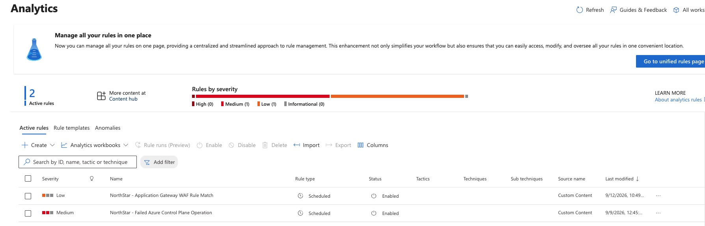
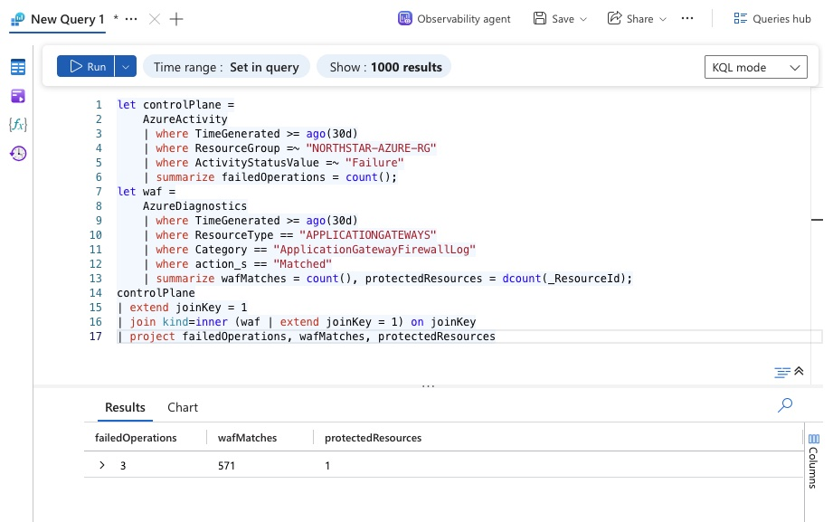
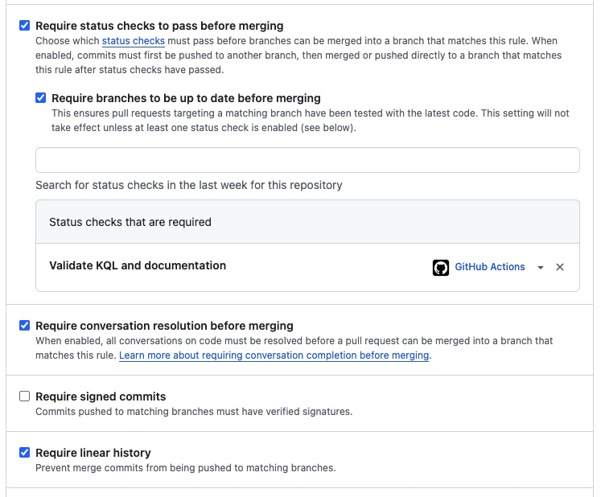

# Evidence Register

Evidence must demonstrate implemented controls without exposing tenant IDs, subscription IDs, workspace IDs, object IDs, credentials, tokens, personal data, or public IP addresses.

Screenshots must be cropped and sanitized before publication. Simulated evidence must be clearly labeled.

## Evidence Manifest

| File | Demonstrates | Source |
|---|---|---|
| `01-sentinel-analytics-rules.jpg` | Two enabled NorthStar scheduled analytics rules with Low and Medium severities | Microsoft Sentinel Analytics |
| `02-sentinel-telemetry-validation.jpg` | Sanitized aggregate validation: 3 failed control-plane events, 571 WAF matches, and 1 protected resource | Log Analytics |
| `03-github-protected-gate.jpg` | Required KQL/documentation validation, strict synchronization, conversation resolution, and linear history | GitHub branch protection |
| `operational-validation/latest.json` | Ten successful expected-versus-actual checks covering Azure subscription, Log Analytics, Sentinel enablement, and analytics-rule configuration | PowerShell, Azure CLI, and Microsoft Sentinel |
| `soar-validation/validation-summary.json` | Telemetry-based WAF tuning, 455-incident remediation, approval automation tests, managed-identity playbook execution, RBAC recovery, and final queue reconciliation | KQL, Microsoft Sentinel, Azure Logic Apps, managed identity, and Azure RBAC |

## Evidence Gallery

### Sentinel Analytics Rules

### Sanitized Telemetry Validation

### Protected Delivery Gate

### Operational State Validation

[View the sanitized 10/10 validation result](operational-validation/latest.json)

[View the successful passwordless GitHub Actions run](https://github.com/gdiangana-alt/northstar-azure-security-operations/actions/runs/38154404431)

### Sentinel and Approval-Gated SOAR

[View the sanitized SOAR validation summary](soar-validation/validation-summary.json)

[View the operating model and implementation report](../docs/sentinel-defender-soar-operating-model.md)
